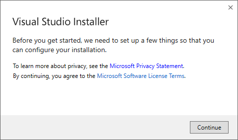
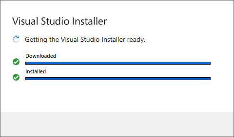
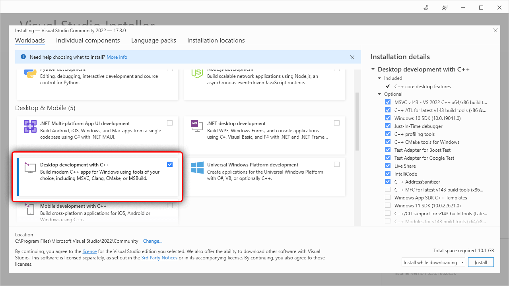
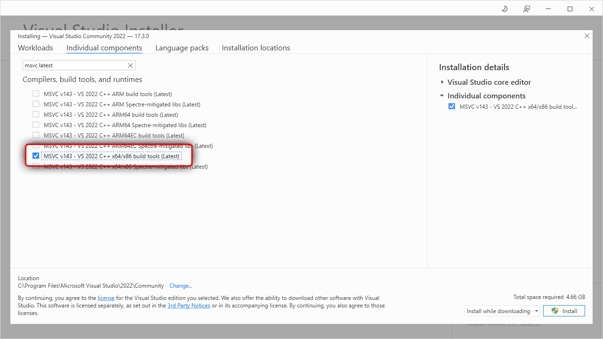
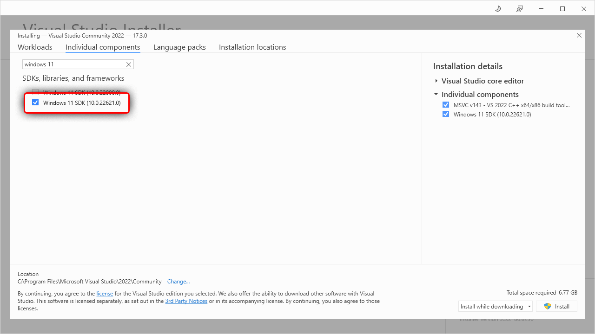
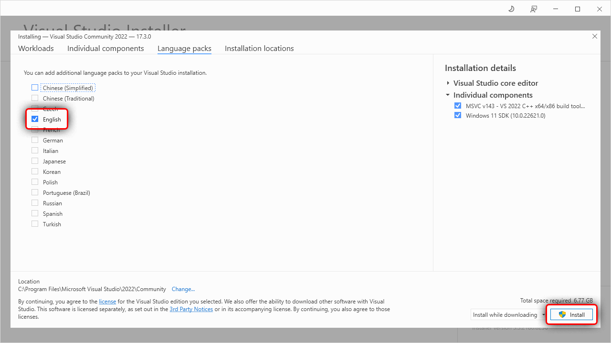
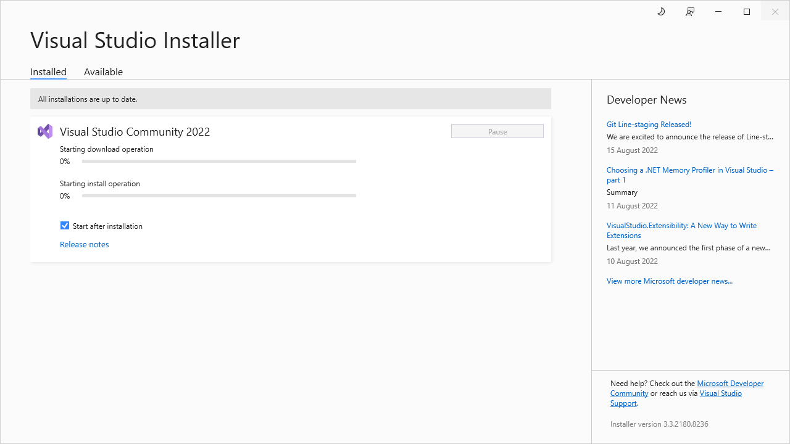

# MSVC prerequisites

Rust's `msvc` targets need the MSVC linker and a Windows SDK.
Install both, then Rust, with [WinGet] in PowerShell or Command Prompt:

```console
winget install -e --id Microsoft.VisualStudio.BuildTools --interactive --custom "--add Microsoft.VisualStudio.Component.VC.Tools.x86.x64 --add Microsoft.VisualStudio.Component.VC.Tools.ARM64 --add Microsoft.VisualStudio.Component.Windows11SDK.26100 --addProductLang En-us"
winget install -e --id Rustlang.Rustup
```

The Visual Studio Installer opens so you can review and confirm, and it needs administrator permission. When it finishes, open a new terminal.

You don't need this for the GNU toolchain (`*-pc-windows-gnu`) or WSL. See [Windows].

## What the command installs

| Component | Why Rust needs it |
| --- | --- |
| `VC.Tools.x86.x64` | Linker (`link.exe`) and C runtime for x64 and x86 |
| `VC.Tools.ARM64` | Linker and C runtime for ARM64 |
| `Windows11SDK.26100` | Windows import libraries, such as `kernel32.lib` |
| English language pack | English linker messages, which `rustc` requests |

If you only build for one architecture, remove the other `VC.Tools` component to save disk space.
Any recent Windows SDK works for Rust code; 26100 is the one `rustup-init` uses. If you also build C or C++ code, use the SDK that code needs.
`Microsoft.VisualStudio.BuildTools` installs the latest Build Tools (currently 2026). For 2022, use `Microsoft.VisualStudio.2022.BuildTools`; the component IDs are the same.
The `Rustlang.Rust.MSVC` WinGet package installs Rust itself, not these prerequisites.

## Licensing

Installing the MSVC build tools requires a Visual Studio license.
Visual Studio Community is free for individuals, open-source projects and small teams.
See the [Build Tools license terms][vs buildtools licence] for details.

## If you already have Visual Studio

WinGet won't add components to an existing install. Open **Visual Studio Installer**, choose **Modify**, and add the [components above](#what-the-command-installs).

## Installing with rustup-init

On x64 and x86 Windows with no Visual Studio, [rustup-init] offers to install Visual Studio 2022 Community with the x64/x86 tools, SDK 26100 and the English language pack. Community [licensing](#licensing) applies.
It doesn't offer this on ARM64, when Visual Studio is already installed, or when run with `-y` (which `winget install Rustlang.Rustup` does). Use the command at the top instead.

## Manual install

Download [Visual Studio or Build Tools][vs downloads], select **Desktop development with C++** (or only the [components above](#what-the-command-installs)), add the English language pack, and install.
The screenshots show Visual Studio 2022; 2026 works the same way.

Accept the license:




Select **Desktop development with C++**:



Or, for a smaller install, select only the MSVC build tools and a Windows SDK under **Individual components**:




Add English under **Language packs**:



Install:



## Troubleshooting

- **``linker `link.exe` not found``**: the MSVC build tools for your architecture aren't installed.
  Add the matching component from the [table above](#what-the-command-installs).
- **`LNK1181: cannot open input file 'kernel32.lib'`** (or another Windows `.lib`): the Windows SDK is missing. Add a Windows SDK component, or run `winget install -e --id Microsoft.WindowsSDK.10.0.26100`.
- **`link: extra operand`** or other unexpected `link` errors: a different `link.exe`, such as the one from Git for Windows, was found on your `PATH` instead of the MSVC linker.
  This usually means the MSVC build tools aren't installed.
- If you installed the prerequisites after installing Rust, open a new terminal and try again.
  You don't need to reinstall Rust.

[Windows]: windows.md
[WinGet]: https://learn.microsoft.com/windows/package-manager/winget/
[rustup-init]: https://rustup.rs
[vs downloads]: https://visualstudio.microsoft.com/downloads/
[vs buildtools licence]: https://visualstudio.microsoft.com/license-terms/vs2026-ga-diagnostic-buildtools/
